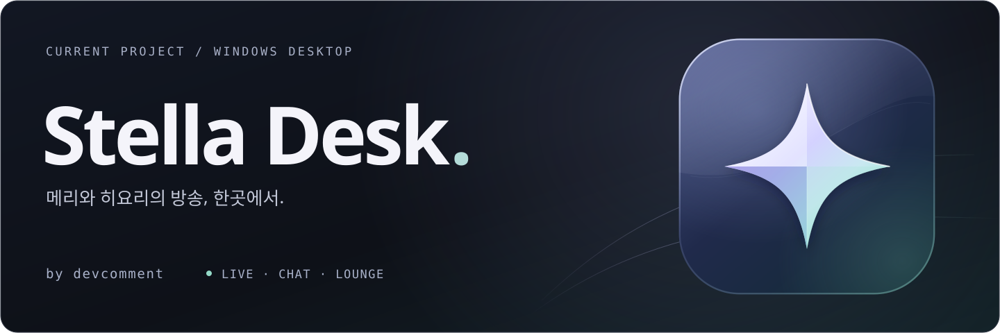

  
    
  <samp>building a little home for live moments</samp>
    

### ✦ &nbsp; Stella Desk

방송과 채팅, 클립·다시보기, 소식을 한곳에 모으는 **Windows 데스크톱 앱**을 만들고 있습니다.

토키노 메리와 하나요 히요리를 위한 비공식 뷰어입니다.

  <a href="https://github.com/devcomment/stella-desk-releases">프로젝트 보기 ↗</a>
  &nbsp; · &nbsp;
  <a href="https://github.com/devcomment/stella-desk-releases/releases/latest">최신 버전 다운로드 ↗</a>

 

### ✦ &nbsp; Stack

  
  
  
  
  

| 영역 | 사용 기술 |
| :--- | :--- |
| 데스크톱 앱 | Electron · Node.js |
| 화면과 인터랙션 | JavaScript · HTML · CSS |
| 빌드·배포·업데이트 | electron-builder · esbuild · electron-updater |
| 라이브러리 | Cheerio · LiquidGlass (Beta) |

 

  <samp>devcomment · Stella Desk</samp>
    
  <a href="https://github.com/devcomment/stella-desk-releases/releases/latest">download</a>
  &nbsp; · &nbsp;
  <a href="https://github.com/devcomment/stella-desk-releases">project</a>
    
  <samp>✦</samp>

