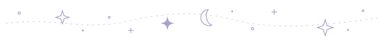
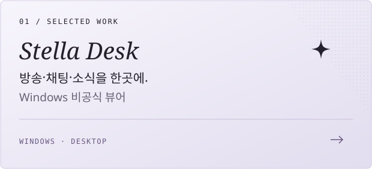
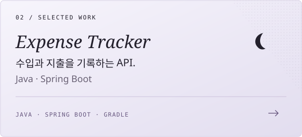

  
    
  <samp>✦ &nbsp; a little space of my own &nbsp; ✦</samp>
    
  작은 취향을 모아, 좋아하는 것을 만듭니다.
    
  

 

### ✦ &nbsp; selected works

  
  

 

  <samp>say hello</samp>
    
  <a href="mailto:beugeumj@naver.com">email</a>
  &nbsp; · &nbsp;
  <a href="https://github.com/devcomment?tab=repositories">repositories</a>
     
  <samp>☾ &nbsp; ⋆ &nbsp; ˚ &nbsp; ✦ &nbsp; ˚ &nbsp; ⋆</samp>

