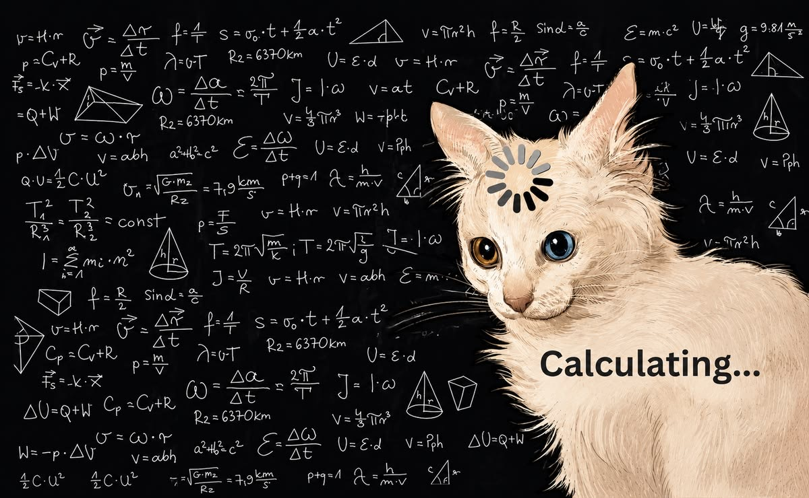

  

  Working on <a href="https://github.com/devcomment/stella-desk-releases">Stella Desk</a>.

  <samp>
    <a href="#projects">projects</a> ·
    <a href="#stack">stack</a> ·
    <a href="https://github.com/devcomment?tab=repositories">repositories ↗</a>
  </samp>

## Projects

### [Stella Desk](https://github.com/devcomment/stella-desk-releases)

A Windows app for Merry and Hiyori's streams, chat, and updates.

Electron · JavaScript · Node.js

[Download for Windows ↗](https://github.com/devcomment/stella-desk-releases/releases) &nbsp; · &nbsp; [About the app ↗](https://github.com/devcomment/stella-desk-releases)

### [Expense Tracker API ↗](https://github.com/devcomment/expense-tracker-api)

An income and expense API built with Java and Spring Boot.

Java · Spring Boot

## Stack

Apps &amp; web

  <picture><source media="(prefers-color-scheme: dark)" srcset="./assets/icons/javascript-dark.svg" /></picture>
  <picture><source media="(prefers-color-scheme: dark)" srcset="./assets/icons/electron-dark.svg" /></picture>
  <picture><source media="(prefers-color-scheme: dark)" srcset="./assets/icons/html5-dark.svg" /></picture>
  <picture><source media="(prefers-color-scheme: dark)" srcset="./assets/icons/css3-dark.svg" /></picture>

Backend

  <picture><source media="(prefers-color-scheme: dark)" srcset="./assets/icons/nodejs-dark.svg" /></picture>
  <picture><source media="(prefers-color-scheme: dark)" srcset="./assets/icons/java-dark.svg" /></picture>
  <picture><source media="(prefers-color-scheme: dark)" srcset="./assets/icons/spring-dark.svg" /></picture>

---

<samp><a href="https://github.com/devcomment?tab=repositories">All repositories ↗</a></samp>

